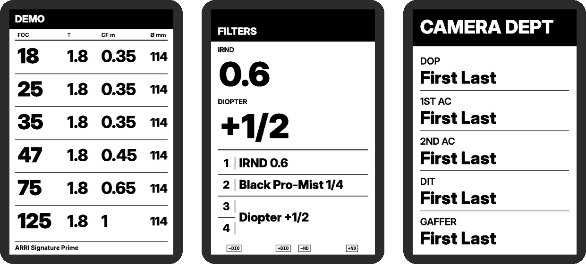

[English](README.md) · Italiano

# CamTag

**Un badge e-paper per il reparto camera.** Lens chart, filtri, crew e note su
un piccolo schermo e-paper montato sulla camera: si legge in pieno sole, resta
visibile da spento e gira insieme alla camera.

<!-- VIDEO DI LANCIO: quando c'è il video di 30–60 s dal set, trascina l'.mp4
nell'editor di GitHub su questa riga (diventa un link user-attachments che si
vede dentro la pagina) e tieni l'immagine qui sotto come riserva. -->


**[▶ Provalo nel browser](https://trunk-studio-production.github.io/camtag/)**:
non serve il dispositivo. Crei le card nel [configuratore web](https://trunk-studio-production.github.io/camtag/) e le provi nel
simulatore, tasti compresi.

## Cos'è

CamTag è un **firmware**, il programma che fa funzionare un dispositivo, per lo
**[Xteink X3](https://www.xteink.com)**: un piccolo lettore e-paper tascabile,
nato per leggere libri, con uno schermo da circa 3,7 pollici, tasti fisici,
batteria, Bluetooth e un accelerometro. CamTag prende il posto del firmware
originale e lo trasforma in un badge per la camera; le card che mostra si
preparano nel [configuratore web](https://trunk-studio-production.github.io/camtag/),
dal browser.

CamTag è un progetto indipendente e open source, non affiliato a Xteink.

## Cosa fa

- **Lens chart fatta per te.** Scegli il tuo set da un database di oltre 1.500
  ottiche cine e foto (210 serie), con T, distanza minima e Ø frontale presi
  dalle schede dei costruttori. Un esemplare del noleggio diverso (un anello
  frontale diverso, per esempio) è una modifica locale, segnata con `*`.
- **Schermata filtri.** ND e diottria si cambiano con i bilancieri, e gli
  stadi del mattebox mostrano cosa c'è davanti alla lente, stadio per stadio.
- **Crew, note, immagini.** Tutte le altre card che servono sulla camera.
- **Gira con la camera.** L'accelerometro interno ruota il contenuto nei
  quattro versi, e la rotazione si può bloccare.
- **Senza fili.** Le card (e gli aggiornamenti del firmware) partono dal
  browser via Bluetooth, oppure si copiano sulla microSD.
- **Batteria.** Circa due giorni e mezzo di uso vero sul set, quasi due
  settimane a riposo. Da spento continua a mostrare la schermata di spento
  (nome della camera, logo).
- **Inglese e italiano**, per il dispositivo, le card e il [configuratore web](https://trunk-studio-production.github.io/camtag/).

## Cosa serve

- Un **[Xteink X3](https://www.xteink.com)**, su cui installare CamTag al
  posto del firmware originale.
- Il **cavo USB dell'X3** (quello in dotazione, collegato direttamente) **e un
  computer con Chrome o Edge** per la prima installazione. Dopo, card e aggiornamenti viaggiano via Bluetooth.
- Un modo per montarlo: il velcro adesivo sulla cover che arriva con l'X3
  funziona bene, o quello che usi per gli altri accessori.

> **⚠️ Firmware non ufficiale: lo carichi a tuo rischio.** CamTag sostituisce il
> firmware dell'X3 e, nel caso peggiore, può lasciarlo inutilizzabile senza
> rimedio. Non c'è alcuna garanzia. Prima di caricarlo leggi
> [Installare CamTag](#installare-camtag).

## Per cominciare

1. Crea le card nel [configuratore web](https://trunk-studio-production.github.io/camtag/).
2. Collega l'X3 e apri **[Installa via USB](https://trunk-studio-production.github.io/camtag/companion/install/)**
   con Chrome o Edge: fa i [controlli di sicurezza](#installare-camtag),
   salva un backup completo e installa CamTag.
3. Manda le card via Bluetooth (tieni **X** sull'X3) o con la microSD.

Il [manuale d'uso](https://trunk-studio-production.github.io/camtag/companion/manuale/)
spiega ogni tasto e ogni schermata.

## Contribuire

- **Manca un set di lenti o di filtri?**
  [Aggiungi un set di lenti](https://github.com/Trunk-Studio-Production/camtag/issues/new?template=lens-set.yml)
  o [un set di filtri](https://github.com/Trunk-Studio-Production/camtag/issues/new?template=filter-set.yml)
  (moduli in inglese): niente codice né JSON, bastano i valori e il link alla
  pagina o alla scheda del costruttore. Li controlliamo lì e aggiungiamo
  tutto il set.
- **Usi CamTag su una produzione?** Ci piacerebbe una foto in macchina:
  [mandala](https://github.com/Trunk-Studio-Production/camtag/issues/new?template=on-set.yml).
  <!-- INSTAGRAM: aggiungere l'account quando esiste ("o taggaci su Instagram"). -->
- **Bug e idee**: [lascia un feedback](https://docs.google.com/forms/d/e/1FAIpQLScKDtH_sSsTYCXE1RcCu_j1RstG9DVZ3qSJUx8GG6IBqvmS4Q/viewform) con un modulo breve, senza account (lo stesso link è in fondo al configuratore web), o [apri una issue](https://github.com/Trunk-Studio-Production/camtag/issues/new/choose) se usi GitHub.
- **Vuoi mettere mano al codice?** La parte tecnica è in fondo, in [Per sviluppatori](#per-sviluppatori).

Fatto in Italia da [Trunk Studio Production](https://github.com/Trunk-Studio-Production),
provato sul set da assistenti operatore al lavoro. Software libero sotto GPL v3.

## Come funziona

1. Nel [configuratore web](https://trunk-studio-production.github.io/camtag/) crei le card.
2. Le mandi all'X3 in uno di due modi:
   - **Bluetooth**: sull'X3 tieni premuto **X** finché compare BLUETOOTH, poi
     nel [configuratore web](https://trunk-studio-production.github.io/camtag/) tocca **Bluetooth** e poi **Invia le card** (vedi sotto);
   - **microSD**: scarichi lo zip e copi la sua cartella `camtag/` nella radice
     della microSD.
3. Sul dispositivo:
   - **X** (lato sinistro): card precedente; **Y** (lato destro): successiva,
     in ciclo
   - **X tenuto premuto (0,8 s)**: ricezione delle card via Bluetooth
   - **Y tenuto premuto (0,8 s)**: blocca/sblocca la rotazione
   - le pressioni lunghe scattano mentre tieni premuto, allo scadere del
     tempo: non serve rilasciare per vedere l'effetto
   - A, B, C, D non cambiano card: sfogliano le pagine della lens chart e, sulla
     schermata filtri, cambiano ND e diottria (indicazioni accanto ai tasti)
   - **schermata filtri**: tieni **A** o **B** per modificare gli stadi del
     mattebox (A/B scelgono lo stadio, C/D il vetro); si esce con X o Y, tenendo
     di nuovo A o B, o da soli dopo 5 s senza tocchi (`docs/filtri.md`)
   - **power**: blocca e sblocca i tasti. La pagina resta com'è, con un
     lucchetto accanto al power
   - **power tenuto premuto (1 s)**: spegne; da spento, accende sull'ultima
     card
   - da acceso sente i tasti in ogni momento: tra una pressione e l'altra
     riposa, ma da fuori non si vede. Dimenticato acceso, si spegne dopo 24 ore
     senza tasti
   - da spento mostra la **schermata di spento** (una scheda scelta nello
     [configuratore web](https://trunk-studio-production.github.io/camtag/), o il solo nome) con una fascia che dice che è spento; dopo
     tre giorni lo schermo passa al bianco. Dettagli e consumi in
     [`docs/batteria.md`](docs/batteria.md)

### Invio via Bluetooth

Il [configuratore web](https://trunk-studio-production.github.io/camtag/) può mandare le card all'X3 senza togliere la microSD, con il
Bluetooth LE del browser (Web Bluetooth).

1. Sull'X3 tieni premuto **X** per 0,8 s: compare **BLUETOOTH** con il nome
   del dispositivo (es. `CAMTAG-1A2B`).
2. Nel [configuratore web](https://trunk-studio-production.github.io/camtag/) tocca **Bluetooth**, poi **Invia le card** e
   scegli il dispositivo.
3. A fine invio l'X3 mostra la prima card con **CARD AGGIORNATE**.

Le card arrivano in una cartella temporanea e sostituiscono quelle di prima
solo a invio completo e controllato: se il collegamento cade o qualcosa va
storto, sull'X3 restano le card di prima. **X** o **Y** escono dalla
ricezione; dopo 3 minuti senza invii esce da sola. Il Bluetooth è acceso
solo in ricezione.

Con le card arriva sull'X3 anche il **progetto** (`project.json`): lo stesso
file di "Salva progetto". Il lavoro nel [configuratore web](https://trunk-studio-production.github.io/camtag/) resta solo nel browser,
che può cancellarlo (Safari lo fa dopo una settimana senza visite). Per
riprenderlo, metti l'X3 in ricezione e tocca **Bluetooth** → **Importa
dall'X3**: le card non cambiano. In alternativa apri `camtag/project.json`
della microSD con **Importa progetto**.

Requisiti:
- **Android, Mac, Windows, Linux**: Chrome, Edge o Brave (provato su Mac; in
  Brave il Bluetooth va acceso in `brave://flags`, voce "Web Bluetooth API");
- **iPhone e iPad**: Safari non ha Web Bluetooth; serve un browser che lo
  aggiunga: **[BLE Link](https://apps.apple.com/app/id6468414672)** o
  **[Bluefy](https://apps.apple.com/app/id1492822055)**, provati tutti e due
  (invio, "Importa dall'X3" e aggiornamento del firmware).

Il protocollo è descritto in [`docs/bluetooth.md`](docs/bluetooth.md).

### Rotazione automatica

L'X3 ha un IMU QMI8658 (accelerometro + giroscopio). Il firmware legge la
gravità e gira la card nei 4 versi, con un po' di isteresi: il cambio avviene
dopo circa 0,6 s di posizione stabile. Se il dispositivo è appoggiato in piano,
mantiene il verso attuale.

Ogni card è esportata in due file, accoppiati per nome:

| File | Formato |
|---|---|
| `01_lens_35mm.bmp` | orizzontale, 792×528 |
| `01_lens_35mm.p.bmp` | verticale, 528×792 |

Il firmware sceglie la variante adatta e la ruota di 0° o 180°. Se una card ha
solo una delle due varianti, la usa anche nell'altro orientamento, ruotata.

La rotazione funziona mentre il dispositivo è acceso, anche a riposo. Da spento
resta la schermata di spento nell'ultimo verso.

Il blocco è salvato e sopravvive allo spegnimento. L'X4 non ha IMU: lì la
rotazione resta fissa.

### Lingue

Le scritte del firmware dell'X3 (avviso senza card, schermata Bluetooth, fascia
di spento, errori) sono in inglese o in italiano. Al primo avvio l'X3 chiede la
lingua (**A** o **B** = inglese, **C** o **D** = italiano) e la richiede a ogni
avvio finché non ne viene scelta una. Si può impostare anche dal [configuratore web](https://trunk-studio-production.github.io/camtag/)
web, che scrive `lang=en|it` in `/camtag/settings.ini` con il prossimo invio
delle card ("Non cambiare" non scrive nulla).

Il [configuratore web](https://trunk-studio-production.github.io/camtag/) ha tre scelte di lingua indipendenti, nel pulsante EN/IT della
barra in alto:
- **interfaccia**: per browser; di partenza italiano se la lingua del sistema
  è l'italiano, altrimenti inglese;
- **card**: per progetto, salvata in `project.json`;
- **scritte dell'X3**.

Card e X3 in lingue diverse vanno bene: nessuno lo controlla. Il manuale d'uso
c'è in inglese (`companion/manual/`) e in italiano (`companion/manuale/`).

## Configuratore web

Online: **https://trunk-studio-production.github.io/camtag/** (GitHub Pages,
aggiornato a ogni push su `main`). È anche l'indirizzo da aprire sul telefono
per l'invio via Bluetooth.

Le schermate usano il font **Inter** (© The Inter Project Authors, licenza SIL
Open Font License 1.1), incluso in `companion/fonts/` insieme alla sua licenza.

I dati restano nel browser; "Salva progetto" esporta un JSON da reimportare.

Schermate:
- **Lens chart** (automatica): cerchi nel database e aggiungi le lenti, una
  per una o tutta la serie; le lenti mancanti si inseriscono a mano. La lente
  "fuori dal coro" va in negativo; si può forzare per ogni lente.
- **Filtri** (automatica): kit ND e diottrie (i tasti +/− del dispositivo
  scorrono solo questi), formato ND, kit dei vetri (più gradazioni per famiglia in un colpo) e stadi del mattebox, da 1 a 3 (il `+` apre 4, 5 e 6, per mattebox più grandi o un vetro montato fuori; vedi `docs/filtri.md`).
- **Schede manuali**: lista (righe voce e valore: crew, contatti…), note, lente singola, immagine (un logo, un QR…).

"Progetto ▾ › Scarica le card (.zip)" crea `camtag.zip`: la cartella `camtag/` va copiata nella
radice della microSD.

**Simulatore** (pulsante sopra l'anteprima): l'X3 disegnato con tutti i tasti
cliccabili (anche da tastiera: A–D, X e Y, P = power). X (precedente) e Y
(successivo) cambiano tipo di pagina in ciclo (lenti, filtri, elenco filtri,
note, liste, immagini); A–D sfogliano le pagine dello stesso tipo, tranne sui
filtri, dove cambiano diottria e ND. Si può ruotare, bloccare la
rotazione (Y tenuto premuto) e spegnere (power tenuto premuto), e si comporta
come è previsto per il firmware. Le schermate sono a risoluzione piena (792×528 e 528×792); il
simulatore le mostra a circa metà scala, vicino alla dimensione reale.

## Installare CamTag

**Caricare CamTag può rendere l'X3 inutilizzabile.** Leggi questa parte per
intero prima di collegare il cavo.

Installa dalla **[pagina di installazione](https://trunk-studio-production.github.io/camtag/companion/install/)**, con Chrome o Edge su un
computer e il cavo USB dell'X3. È la strada consigliata: non serve installare
niente, ed è provata dall'inizio alla fine su un X3 con il firmware originale.

1. Accendi l'X3 e collegalo al computer: da spento non compare sulla USB.
2. La pagina fa tre **controlli di sicurezza** (l'X3 compare sulla USB, il chip
   non ha protezioni attive, la memoria si legge senza errori) e **si ferma se
   uno non passa**.
3. Salva un **backup completo** della memoria (16 MB, meno di un minuto), letto
   e verificato con l'impronta che l'X3 calcola da sé. Senza backup non va
   avanti.
4. Installa CamTag (pochi secondi) e riavvia l'X3.

**Il cavo deve restare ben innestato e fermo per tutta la procedura.**
Collegalo direttamente all'X3, senza adattatori: anche quelli magnetici, con un
cavo appena un po' rigido, possono spostarsi e far saltare il contatto. Se il
collegamento cade mentre scrive, la pagina lo segnala: ricollega bene il cavo
senza spegnere l'X3 e riprova; se non basta, il backup lo riporta com'era.

**Conserva il backup in almeno due posti.** È la copia esatta del tuo
dispositivo e l'unico modo per tornare allo stato di fabbrica. Contiene i dati
della tua unità: non pubblicarlo.

Se durante la procedura l'X3 resta bloccato (schermo fermo, tasti che non
rispondono): premi **RESET**, poi tieni premuto **power** per 3-5 secondi.

Dopo la prima installazione gli aggiornamenti arrivano via Bluetooth
("Aggiorna firmware" nel [configuratore web](https://trunk-studio-production.github.io/camtag/)).

### Cosa può andare storto

- CamTag è un firmware non ufficiale, senza alcun legame con Xteink. Il
  caricamento sostituisce il firmware originale, il bootloader e la tabella
  partizioni, e può far decadere la garanzia del dispositivo.
- **Il primo caricamento passa sempre dalla USB.** Dal firmware 0.4.0 CamTag
  si aggiorna anche via Bluetooth ("Aggiorna firmware" nel [configuratore web](https://trunk-studio-production.github.io/camtag/),
  con la conferma sui tasti dell'X3), ma solo con altre versioni di CamTag:
  per tornare al firmware originale o a CrossPoint serve la USB. Se sul tuo X3
  la USB non funziona, non caricarci CamTag.
- **Alcune unità escono di fabbrica con il caricamento USB bloccato**, in
  particolare quelle vendute da negozi terzi e non da xteink.com (lo documenta
  [CrossPoint](https://github.com/crosspoint-reader/crosspoint-reader#usb-locked-devices-xteink-unlocker)).
  Su un'unità bloccata un firmware non previsto dal loro strumento di sblocco
  può lasciare il dispositivo fermo per sempre, e CamTag non è tra quelli
  previsti. **Su un'unità bloccata non caricare CamTag.**
- Come funzioni quel blocco non lo sappiamo. I controlli della pagina di installazione dicono
  con ragionevole sicurezza se un X3 è a rischio, ma non sono una garanzia.
- Finora CamTag è stato provato su un solo X3: comprato da un negozio terzo,
  con firmware originale V6.1.15, e non bloccato.

### Ripristino

- Backup completo, che riporta l'X3 esattamente com'era: "Ripristina da un
  backup" nella [pagina di installazione](https://trunk-studio-production.github.io/camtag/companion/install/).
- Firmware originale Xteink o CrossPoint: dal flasher web su crosspointreader.com.
  La tabella partizioni di CamTag è la stessa di CrossPoint.

Entrambe le strade passano dalla USB, con l'X3 acceso (con CamTag: se è spento
tieni premuto il power; collegato a un computer resta sveglio). Se la USB non risponde più,
resta solo riscrivere la memoria con un programmatore esterno aprendo il
dispositivo, come descrive
[CrossPoint](https://github.com/crosspoint-reader/crosspoint-reader/blob/HEAD/docs/fix-bricked-xteink.md):
un'operazione delicata, che può finire di romperlo.

<br>

---

## Per sviluppatori

> **Da qui in giù è la parte tecnica**: com'è fatto il codice, come si compila
> il firmware e cosa resta da provare sull'hardware. Per usare CamTag non serve:
> parti da [Per cominciare](#per-cominciare).

### Struttura

| Cartella | Contenuto |
|---|---|
| `device/` | Firmware PlatformIO per Xteink X3 (e X4), sopra FreeInk SDK |
| `companion/` | Configuratore web per creare le card ed esportarle in BMP 1 bit |
| `third_party/freeink-sdk/` | FreeInk SDK (driver display, tasti, batteria, SD), sottomodulo su `77ae8c7` |
| `reference/crosspoint/` | CrossPoint, solo come riferimento: non compilato e non nel repo |
| `.venv/` | PlatformIO recente, isolato dal resto del sistema |
| `data/` | Database lenti e catalogo filtri |

**Modalità sviluppatore** del [configuratore web](https://trunk-studio-production.github.io/camtag/): apri la pagina con `?dev`
(resta accesa nel browser, `?dev=0` la spegne). Nella finestra Bluetooth
compaiono "Registro batteria" e, con Maiusc su "Aggiorna firmware", la scelta
di un `.bin` da installare.

#### Dopo un clone

```bash
git submodule update --init
python3.13 -m venv .venv && .venv/bin/pip install platformio
git clone --depth 1 https://github.com/crosspoint-reader/crosspoint-reader reference/crosspoint
```

`.venv/` e `reference/` non sono nel repo: vanno ricreati così.

#### Configuratore web in locale

Dalla radice del progetto (serve anche `data/`, con il database lenti):

```bash
python3 -m http.server 8766
```

Poi apri http://localhost:8766/companion/. Il Bluetooth funziona anche così: il
browser lo dà solo alle pagine in HTTPS o da `localhost`, non a un altro
indirizzo su `http://`.

### Firmware

Compila:

```bash
cd device && ../.venv/bin/pio run -e x3
```

Test sull'host, senza X3:

```bash
device/test/filters_test.sh      # schermata filtri: uguale all'anteprima del configuratore web
```

`filters_test.sh` compone i pezzi esportati dal [configuratore web](https://trunk-studio-production.github.io/camtag/) come fa il
firmware e li confronta pixel per pixel con le anteprime, insieme alle regole
degli stadi. I dati stanno in `device/test/filters_fixture.zip`: se cambia
l'esportazione dei filtri va rigenerato con `device/test/filters_fixture.js`
(istruzioni nel file).

### Installare dal terminale

Per chi lavora sul firmware: gli stessi passi della
[pagina di installazione](#installare-camtag), con `esptool`. Valgono gli stessi
rischi; chi usa CamTag e basta installi dalla pagina.

#### Controlli: se anche uno solo non passa, non caricare

Servono il cavo USB dell'X3 e l'X3 **acceso**: da spento non compare
sulla USB. `esptool` è quello che PlatformIO installa alla prima compilazione
(se manca: `.venv/bin/pip install esptool`, poi `.venv/bin/python -m esptool`).
Qui sotto `esptool` sta per `~/.platformio/penv/bin/python -m esptool --chip esp32c3`.

1. **L'X3 compare sulla USB.** Con il firmware originale in funzione:

   ```bash
   ls /dev/cu.usbmodem*        # macOS; su Linux /dev/ttyACM*
   ```

   Se non compare, prova un altro cavo e un'altra porta. Se continua a non
   comparire, è il segno di un'unità bloccata: fermati.

2. **Il chip non ha protezioni attive.**

   ```bash
   esptool get-security-info
   ```

   Devi leggere `Flags: 0x00000000`, `Secure Boot: Disabled` e
   `Flash Encryption: Disabled`, e prima `Stub flasher running`. Con valori
   diversi, o se esptool non riesce a collegarsi, fermati.

3. **Tutta la flash si legge, due volte uguale.** È anche il backup:

   ```bash
   esptool read-flash 0 0x1000000 backup-x3-originale.bin
   esptool read-flash 0 0x1000000 backup-x3-rilettura.bin
   shasum -a 256 backup-x3-originale.bin backup-x3-rilettura.bin
   ```

   Ogni lettura dura circa un minuto e deve dare 16777216 byte; le due impronte
   devono essere identiche. Se una lettura fallisce o le impronte differiscono,
   fermati.

Dopo ogni comando esptool riavvia l'X3, e il firmware originale torna in sonno:
premi il power e controlla che riparta come prima.

**Conserva `backup-x3-originale.bin` in almeno due posti.** È la copia esatta del
tuo dispositivo e l'unico modo per tornare allo stato di fabbrica. Contiene i
dati della tua unità: non pubblicarlo.

#### Caricare

Solo con i tre controlli passati e il backup al sicuro, da un clone di
questo repository preparato come in [Dopo un clone](#dopo-un-clone):

```bash
cd device && ../.venv/bin/pio run -e x3 -t upload && ../.venv/bin/pio device monitor
```

Tieni l'X3 sveglio e collegato finché il caricamento non ha finito.

#### Ripristino dal terminale

```bash
~/.platformio/penv/bin/python -m esptool --chip esp32c3 write-flash 0 backup-x3-originale.bin
```

### Da verificare sull'hardware

Le prove si fanno dal terminale con `scripts/taratura.py` (firmware compilato
con `CAMTAG_DEBUG`), che mostra subito ogni tasto premuto, il verso e la card a
schermo, e aspetta l'X3 se si spegne:

```bash
.venv/bin/python scripts/taratura.py tasti
.venv/bin/python scripts/taratura.py versi --carica   # compila e carica prima
.venv/bin/python scripts/taratura.py card             # con le card sopra
.venv/bin/python scripts/taratura.py filtri           # con la schermata filtri sopra
.venv/bin/python scripts/taratura.py log              # registro dal vivo
.venv/bin/python scripts/taratura.py batteria         # consumi misurati (docs/batteria.md)
```

- [x] Rilevamento dell'X3, display e microSD
- [x] Mappatura dei tasti (`kKeyA`…`kKeyD`, `kKeyX`, `kKeyY` in `device/src/main.cpp`)
- [x] Assi IMU e verso dello schermo (`kImuSwapXY`, `kImuSignX`, `kImuSignY`,
      `kQuarterTurns`): la scritta resta dritta nei 4 versi
- [x] Riaccensione con il power
- [x] Acceso sempre in ascolto (riposo in sonno leggero), tasti bloccati con
      il power breve, spento e riaccensione con il power tenuto, schermata di
      spento e passaggio al bianco
- [x] Consumi misurati con `taratura.py batteria` (39 h di registro,
      20-22/11/2026): 25 mA da sveglio, 2,1 mA a riposo (12,6 giorni), 1,8 mA
      a riposo con i tasti bloccati (14,9 giorni), circa 10 mA con un uso vero
      (circa due giorni e mezzo); nessun riavvio da solo né risveglio inutile.
      Dettagli in [`docs/batteria.md`](docs/batteria.md)
- [x] La ricarica si ferma da sola a batteria piena (circa 4,35 V); il fuel
      gauge ha già la capacità giusta (642 mAh)
- [ ] Consumo nei primi tre giorni da spento, prima del bianco
- [x] Ricezione via Bluetooth da Brave sul Mac: crea `/camtag` anche la prima
      volta e mostra quanti file ha ricevuto; "Importa dall'X3" riporta il
      progetto nel browser e lascia le card come sono
- [x] Velocità di ricezione dal Mac: 98 file, 1,1 MB in circa 40 s (erano
      100 s) chiedendo l'intervallo da 15 ms subito dopo lo scambio dell'MTU;
      mouse e tastiera Bluetooth in uso sul Mac rallentano
- [x] Aggiornamento del firmware via Bluetooth: 864 KB in 26 s; il nuovo parte
      in prova e si conferma da sé, altrimenti il bootloader torna al vecchio
- [x] Registro della batteria scaricato via Bluetooth (pulsante "Registro batteria", in modalità sviluppatore)
- [x] Bluetooth da iPhone con BLE Link e Bluefy: invio, importazione e firmware
- [ ] Bluetooth da Android (Chrome)
- [x] Card vere in verticale e in orizzontale, X/Y in ciclo, rotazione
      automatica e blocco (Y tenuto)
- [x] Bilancieri sulla lens chart di più pagine nei 4 versi (come
      `lensPageDir` nel simulatore)
- [x] Schermata filtri (`taratura.py filtri`): legge le card del [configuratore web](https://trunk-studio-production.github.io/camtag/)
      così come sono; ND e diottria con i bilancieri e indicazioni dei tasti nei
      4 versi, riordino degli stadi dopo 2 s, modifica degli stadi (entrata,
      scelta di stadio e vetro, uscita da sola dopo 5 s e con Y); il mezzo
      refresh dopo 2 s fermi toglie l'ombra dei cambi veloci di ND e diottria
- [x] Rotazione bloccata che ferma tutto: girando l'X3 schermata filtri,
      indicazioni e bilancieri restano quelli del verso bloccato
- [x] Nessun tasto perso: prima cadevano tutti durante un aggiornamento dello
      schermo (`taratura.py reattivita`); ora un compito li legge anche lì e li
      mette in coda, e si eseguono appena lo schermo ha finito
- [x] Negativo delle schermate precedenti a schermo fermo: risolto mandando il
      controller in sonno profondo dopo gli aggiornamenti, confermato dopo ore
      d'uso ([`docs/schermo.md`](docs/schermo.md))
- [x] X e Y per tipo di pagina, A–D dentro il tipo (firmware 0.5.0)
- [x] Soglie della rotazione (`kMinTiltG`, `kFlatG`, `ROTATE_STABLE_MS`), confermate in giorni d'uso
- [x] Ghosting: niente ombre con un refresh completo ogni 6 cambi (`FULL_REFRESH_EVERY`)
- [ ] Icona della batteria sulle card sotto il 20% e in carica

### Prossimi passi

1. **Installazione dal browser** (`companion/install/`): provata con Chrome
   su Mac su un X3 con il firmware originale (backup, installazione,
   ripristino); da provare su altre unità e su Windows e Linux.
2. **Feedback dei beta tester** sul set.
3. **Consumo da spento** nei primi tre giorni, e da lì il tempo prima del
   bianco (`OFF_BLANK_S`). Serve anche una configurazione di compilazione
   senza `CAMTAG_DEBUG`: oggi `x3` lo ha sempre acceso.
4. **Schermo** (`docs/schermo.md`): il riposo che scatta con la USB collegata. Il riavvio
   da solo dopo il riposo, visto una volta, non si è più ripresentato in 39 h
   di registro. Caldo oltre i 50 °C circa e sole diretto per mesi rovinano il
   pannello.
5. **Catalogo dei filtri** (`data/filters.json`) verificato sulle schede dei
   costruttori: oggi è provvisorio.

---

## Licenza

CamTag (firmware e [configuratore web](https://trunk-studio-production.github.io/camtag/)) è software libero, distribuito con la
licenza **GNU GPL v3.0**: testo completo in [`LICENSE`](LICENSE). Puoi usarlo,
studiarlo, modificarlo e ridistribuirlo; chi distribuisce una versione
modificata deve renderne disponibile il codice con la stessa licenza.

**Nessuna garanzia.** Come dicono gli articoli 15 e 16 della licenza, il
software è fornito "così com'è": chi lo usa lo fa a proprio rischio, e gli
autori non rispondono di danni a dispositivi, dati o altro, compreso un X3 reso
inutilizzabile dal caricamento del firmware.

Restano con le loro licenze:
- FreeInk SDK (`third_party/freeink-sdk/`): MIT;
- font Inter (`companion/fonts/`): SIL Open Font License 1.1.
