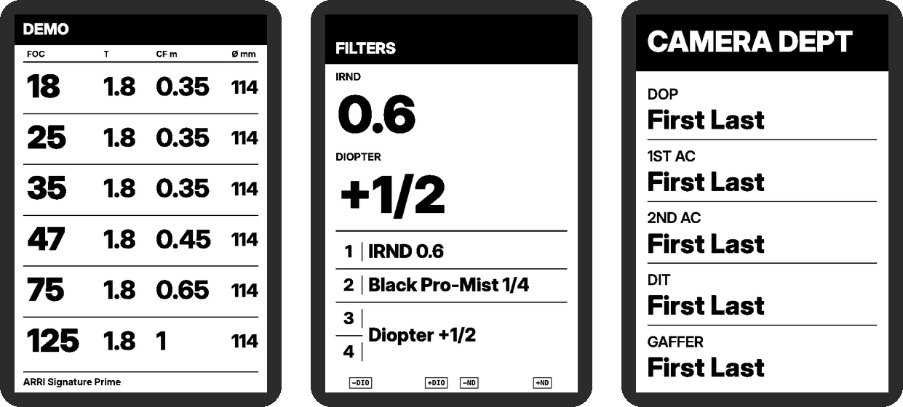

English · [Italiano](README.it.md)

# CamTag

**An e-paper badge for the camera department.** Lens chart, filters, crew and
notes on a small e-paper screen mounted on the camera: readable in full sun,
still there when it's off, and it turns with the camera.

<!-- LAUNCH VIDEO: when the 30–60 s on-set video is ready, drag the .mp4 into
the GitHub editor on this line (it becomes a user-attachments link that plays
inline) and keep the image below as the fallback. -->


**Try before you buy.** The [web configurator](https://trunk-studio-production.github.io/camtag/) has a
simulator: an X3 in your browser, with working buttons, rotation and the
filters screen. Build your cards and watch them work before you get the device.

**[▶ Try it in your browser](https://trunk-studio-production.github.io/camtag/)** (on a computer: on a phone
you get the web configurator, without the simulator).

## What it is

CamTag is **firmware**, the program that runs a device, for the
**[Xteink X3](https://www.xteink.com)**: a small pocket e-paper reader, made
for reading books, with a screen of about 3.7 inches, physical buttons, a
battery, Bluetooth and an accelerometer. CamTag replaces the original firmware
and turns it into a badge for the camera; the cards it shows are prepared in
the [web configurator](https://trunk-studio-production.github.io/camtag/), in
the browser.

CamTag is an independent, open-source project, not affiliated with Xteink.

## What it does

- **Lens chart, built for you.** Pick your set from a database of 1,500+ cine
  and photo lenses (210 series), with T-stop, close focus and front diameter
  from the manufacturers' own data sheets. A rental unit that differs (a
  different front ring, say) is a local edit, marked with `*`.
- **Filters screen.** ND and diopter change with the rocker buttons, and the
  mattebox stages show what's in front of the lens, stage by stage.
- **Crew, notes, images.** Any other card you need on the camera.
- **Turns with the camera.** The built-in accelerometer rotates the content
  to any of four orientations, and you can lock it.
- **Wireless.** Send cards (and firmware updates) from the browser over
  Bluetooth, or copy them to the microSD.
- **Battery.** About two and a half days of real use on set, almost two weeks
  idle. When off, it keeps showing your off screen (camera name, logo).
- **English and Italian**, for the device, the cards and the [web configurator](https://trunk-studio-production.github.io/camtag/).

## What you need

- An **[Xteink X3](https://www.xteink.com)**, to install CamTag on in place of
  the original firmware.
- The **X3's USB cable** (the one in the box, plugged in directly) **and a
  computer with Chrome or Edge** for the first install. After that, cards and updates travel over Bluetooth.
- A way to mount it: adhesive velcro on the cover that comes with the X3
  works well, or whatever you use for your other accessories.

> **⚠️ Unofficial firmware: you flash it at your own risk.** CamTag replaces the
> X3's firmware and, in the worst case, can leave it unusable beyond repair.
> There is no warranty of any kind. Before flashing, read
> [Installing CamTag](#installing-camtag).

## Getting started

1. Make your cards in the [web configurator](https://trunk-studio-production.github.io/camtag/).
2. Connect the X3 and open **[Install via USB](https://trunk-studio-production.github.io/camtag/install/)**
   in Chrome or Edge: it runs the [safety checks](#installing-camtag),
   saves a full backup and installs CamTag.
3. Send the cards over Bluetooth (hold **X** on the X3) or via microSD.

The [user manual](https://trunk-studio-production.github.io/camtag/manual/)
explains every button and screen.

## Contribute

- **A lens or filter set is missing?**
  [Add a lens set](https://github.com/Trunk-Studio-Production/camtag/issues/new?template=lens-set.yml)
  or [add a filter set](https://github.com/Trunk-Studio-Production/camtag/issues/new?template=filter-set.yml):
  no code or JSON needed, just the values and a link to the manufacturer's
  page or data sheet. We check them against it and add the whole set.
- **Using CamTag on a production?** We'd love a photo of it on the camera:
  [send it](https://github.com/Trunk-Studio-Production/camtag/issues/new?template=on-set.yml).
  <!-- INSTAGRAM: add the account here when it exists ("or tag us on Instagram"). -->
- **Bugs and ideas**: [leave feedback](https://docs.google.com/forms/d/e/1FAIpQLScKDtH_sSsTYCXE1RcCu_j1RstG9DVZ3qSJUx8GG6IBqvmS4Q/viewform) with a short form, no account needed (the web configurator has the same link at the bottom), or [open an issue](https://github.com/Trunk-Studio-Production/camtag/issues/new/choose) if you use GitHub.
- **Want to work on the code?** The technical part is at the bottom, under [For developers](#for-developers).

Made in Italy by [Trunk Studio Production](https://github.com/Trunk-Studio-Production),
tested on set by working camera assistants. Free software under the GPL v3.

## How it works

1. Create the cards in the [web configurator](https://trunk-studio-production.github.io/camtag/).
2. Send them to the X3 in one of two ways:
   - **Bluetooth**: on the X3 hold **X** until BLUETOOTH appears, then in the
     [web configurator](https://trunk-studio-production.github.io/camtag/) tap **Bluetooth** and then **Send cards** (see below);
   - **microSD**: download the zip and copy its `camtag/` folder to the root
     of the microSD.
3. On the device:
   - **X** (left side): previous card; **Y** (right side): next, in a loop
   - **X held (0.8 s)**: receive cards via Bluetooth
   - **Y held (0.8 s)**: lock/unlock rotation
   - long presses fire while you are still holding, when the time runs out:
     you don't need to release to see the effect
   - A, B, C, D don't change card: they flip through the pages of the lens
     chart and, on the filters screen, change ND and diopter (hints next to
     the buttons)
   - **filters screen**: hold **A** or **B** to edit the mattebox stages
     (A/B pick the stage, C/D the glass); you exit with X or Y, by holding A
     or B again, or automatically after 5 s without touches (`docs/filtri.md`)
   - **power**: locks and unlocks the buttons. The page stays as it is, with a
     padlock next to the power button
   - **power held (1 s)**: turns off; when off, turns on at the last card
   - when on, it hears the buttons at any moment: between presses it rests,
     but from the outside you can't tell. If left on, it turns itself off
     after 24 hours without button presses
   - when off it shows the **off screen** (a card chosen in the [web configurator](https://trunk-studio-production.github.io/camtag/), or
     just the name) with a strip saying it is off; after three days the screen
     goes white. Details and power consumption in
     [`docs/batteria.md`](docs/batteria.md)

### Sending via Bluetooth

The [web configurator](https://trunk-studio-production.github.io/camtag/) can send the cards to the X3 without removing the microSD, using
the browser's Bluetooth LE (Web Bluetooth).

1. On the X3 hold **X** for 0.8 s: **BLUETOOTH** appears with the device
   name (e.g. `CAMTAG-1A2B`).
2. In the [web configurator](https://trunk-studio-production.github.io/camtag/) tap **Bluetooth**, then **Send cards** and choose the
   device.
3. When the transfer is done the X3 shows the first card with **CARDS
   UPDATED**.

The cards arrive in a temporary folder and replace the previous ones only once
the transfer is complete and checked: if the connection drops or something
goes wrong, the previous cards stay on the X3. **X** or **Y** exit receive
mode; after 3 minutes without transfers it exits by itself. Bluetooth is on
only while receiving.

Along with the cards, the **project** (`project.json`) also reaches the X3:
the same file as "Save project". Your work in the [web configurator](https://trunk-studio-production.github.io/camtag/) lives only in the
browser, which may delete it (Safari does so after a week without visits). To
get it back, put the X3 in receive mode and tap **Bluetooth** → **Import from
X3**: the cards don't change. Alternatively, open `camtag/project.json` from
the microSD with **Import project**.

Requirements:
- **Android, Mac, Windows, Linux**: Chrome, Edge or Brave (tested on Mac; in
  Brave, Bluetooth must be enabled in `brave://flags`, entry "Web Bluetooth
  API");
- **iPhone and iPad**: Safari has no Web Bluetooth; you need a browser that
  adds it: **[BLE Link](https://apps.apple.com/app/id6468414672)** or
  **[Bluefy](https://apps.apple.com/app/id1492822055)**, both tested (sending,
  "Import from X3" and firmware update).

The protocol is described in [`docs/bluetooth.md`](docs/bluetooth.md).

### Automatic rotation

The X3 has a QMI8658 IMU (accelerometer + gyroscope). The firmware reads
gravity and turns the card to any of the 4 orientations, with some hysteresis:
the change happens after about 0.6 s in a stable position. If the device is
lying flat, it keeps the current orientation.

Each card is exported as two files, paired by name:

| File | Format |
|---|---|
| `01_lens_35mm.bmp` | landscape, 792×528 |
| `01_lens_35mm.p.bmp` | portrait, 528×792 |

The firmware picks the right variant and rotates it by 0° or 180°. If a card
has only one of the two variants, it uses it for the other orientation too,
rotated.

Rotation works while the device is on, including at rest. When off, the off
screen stays in the last orientation.

The lock is saved and survives power-off. The X4 has no IMU: there the
rotation stays fixed.

### Languages

The X3 firmware's own messages (no-card notice, Bluetooth screen, off strip,
errors) come in English or Italian. On first boot the X3 asks for the
language (**A** or **B** = English, **C** or **D** = Italian) and keeps asking
at every boot until one is chosen. It can also be set from the [web configurator](https://trunk-studio-production.github.io/camtag/), which
writes `lang=en|it` in `/camtag/settings.ini` with the next card upload
("Don't change" writes nothing).

The [web configurator](https://trunk-studio-production.github.io/camtag/) has three independent language choices, in the EN/IT button of
its top bar:
- **interface**: per browser; defaults to Italian if the system language is
  Italian, otherwise English;
- **cards**: per project, saved in `project.json`;
- **X3 messages**.

Cards and X3 in different languages is fine: nothing checks it. The user
manual exists in English (`companion/manual/`) and Italian
(`companion/manuale/`).

## Web configurator

Online: **https://trunk-studio-production.github.io/camtag/** (GitHub Pages,
updated on every push to `main`). It is also the address to open on your phone
to send via Bluetooth.

The screens use the **Inter** font (© The Inter Project Authors, SIL Open Font
License 1.1), included in `companion/fonts/` together with its license.

Data stays in the browser; "Save project" exports a JSON file to import again later.

Screens:
- **Lens chart** (automatic): search the database and add lenses, one by one
  or a whole series; missing lenses can be entered by hand. The lens that
  "stands out" is shown in negative; this can be forced for each lens.
- **Filters** (automatic): ND and diopter kits (the device's +/− buttons
  cycle only through these), ND format, glass kit (several grades per family
  at once) and mattebox stages, from 1 to 3 (`+` opens 4, 5 and 6, for bigger
  matte boxes or a glass mounted outside; see `docs/filtri.md`).
- **Manual cards**: list (item and value rows: crew, contacts…), notes, single lens, image (a logo, a QR code…).

"Project ▾ › Download cards (.zip)" creates `camtag.zip`: copy the `camtag/` folder to the root of
the microSD.

**Simulator** (button above the preview): the X3 drawn with all buttons
clickable (also from the keyboard: A–D, X and Y, P = power). X (previous) and Y
(next) cycle through the kinds of page (lenses, filters, filter list, notes,
lists, images); A–D page through the same kind, except on the filters, where
they change diopter and ND. You can rotate it, lock
rotation (Y held) and turn it off (power held), and it behaves as the firmware
is meant to. Screens are at full resolution (792×528 and 528×792); the
simulator shows them at about half scale, close to the real size.

## Installing CamTag

**Flashing CamTag can make the X3 unusable.** Read this whole section before
plugging in the cable.

Install from the **[install page](https://trunk-studio-production.github.io/camtag/install/)**, with Chrome or Edge on a computer
and the X3's USB cable. It's the recommended way: nothing to install, and it
has been tested end to end on an X3 with the original firmware.

1. Turn the X3 on and connect it to the computer: when off it doesn't show up
   on USB.
2. The page runs three **safety checks** (the X3 shows up on USB, the chip has
   no protections enabled, the memory reads without errors) and **stops if one
   fails**.
3. It saves a **full backup** of the memory (16 MB, under a minute), read and
   verified against the fingerprint the X3 computes itself. Without a backup it
   doesn't go on.
4. It installs CamTag (a few seconds) and restarts the X3.

**The cable must stay firmly plugged in and still for the whole procedure.**
Connect it straight to the X3, with no adapters: even magnetic ones can shift
with a slightly stiff cable and break the contact. If the connection drops
while writing, the page tells you: plug the cable back in firmly without
turning the X3 off and try again; if that doesn't work, the backup brings it
back as it was.

**Keep the backup in at least two places.** It's the exact copy of your device
and the only way back to the factory state. It contains your unit's data:
don't publish it.

If the X3 gets stuck during the procedure (screen frozen, buttons not
responding): press **RESET**, then hold **power** for 3–5 seconds.

After the first install, updates come over Bluetooth ("Update firmware" in the
[web configurator](https://trunk-studio-production.github.io/camtag/)).

### What can go wrong

- CamTag is unofficial firmware, with no connection to Xteink. Flashing
  replaces the original firmware, the bootloader and the partition table, and
  may void the device's warranty.
- **The first flash always goes through USB.** From firmware 0.4.0 CamTag
  also updates over Bluetooth ("Update firmware" in the [web configurator](https://trunk-studio-production.github.io/camtag/),
  confirmed on the X3's buttons), but only to other CamTag versions: going
  back to the original firmware or to CrossPoint needs USB. If USB doesn't
  work on your X3, don't flash CamTag on it.
- **Some units leave the factory with USB flashing locked**, in particular
  those sold by third-party shops rather than xteink.com (documented by
  [CrossPoint](https://github.com/crosspoint-reader/crosspoint-reader#usb-locked-devices-xteink-unlocker)).
  On a locked unit, firmware not supported by their unlock tool can leave the
  device dead for good, and CamTag is not among the supported ones. **Do not
  flash CamTag on a locked unit.**
- We don't know how that lock works. The install page's checks tell with
  reasonable confidence whether an X3 is at risk, but they are not a guarantee.
- So far CamTag has been tested on a single X3: bought from a third-party
  shop, with original firmware V6.1.15, and not locked.

### Restore

- Full backup, which puts the X3 back exactly as it was: "Restore from a
  backup" on the [install page](https://trunk-studio-production.github.io/camtag/install/).
- Original Xteink firmware or CrossPoint: from the web flasher at
  crosspointreader.com. CamTag's partition table is the same as CrossPoint's.

Both routes go through USB, with the X3 on (with CamTag: if it is off, hold
power; connected to a computer it stays awake). If USB no longer responds,
the only option left is rewriting the memory with an external programmer by
opening the device, as described by
[CrossPoint](https://github.com/crosspoint-reader/crosspoint-reader/blob/HEAD/docs/fix-bricked-xteink.md):
a delicate operation, which may finish breaking it.

<br>

---

## For developers

> **From here down it's the technical part**: how the code is organized, how
> to build the firmware and what is left to try on the hardware. You don't need
> it to use CamTag: start from [Getting started](#getting-started).

### Structure

| Folder | Contents |
|---|---|
| `device/` | PlatformIO firmware for Xteink X3 (and X4), on top of FreeInk SDK |
| `companion/` | Web configurator to create the cards and export them as 1-bit BMP |
| `third_party/freeink-sdk/` | FreeInk SDK (display driver, buttons, battery, SD), submodule at `77ae8c7` |
| `reference/crosspoint/` | CrossPoint, for reference only: not compiled and not in the repo |
| `.venv/` | Recent PlatformIO, isolated from the rest of the system |
| `data/` | Lens database and filter catalog |

**Developer mode** of the [web configurator](https://trunk-studio-production.github.io/camtag/): open the page with `?dev` (it stays
on in that browser, `?dev=0` turns it off). The Bluetooth window then shows
"Battery log" and, with Shift on "Update firmware", lets you pick a `.bin` to
install.

#### After cloning

```bash
git submodule update --init
python3.13 -m venv .venv && .venv/bin/pip install platformio
git clone --depth 1 https://github.com/crosspoint-reader/crosspoint-reader reference/crosspoint
```

`.venv/` and `reference/` are not in the repo: recreate them this way.

#### Web configurator locally

From the project root (`data/`, with the lens database, is needed too):

```bash
python3 -m http.server 8766
```

Then open http://localhost:8766/companion/. Bluetooth works this way too: the
browser gives it only to pages served over HTTPS or from `localhost`, not to
another address over `http://`.

### Firmware

Build:

```bash
cd device && ../.venv/bin/pio run -e x3
```

Host tests, without an X3:

```bash
device/test/filters_test.sh      # filters screen: identical to the web configurator preview
```

`filters_test.sh` composes the pieces exported by the [web configurator](https://trunk-studio-production.github.io/camtag/) the way the
firmware does and compares them pixel by pixel with the previews, along with
the stage rules. The data is in `device/test/filters_fixture.zip`: if the
filters export changes, regenerate it with `device/test/filters_fixture.js`
(instructions in the file).

### Installing from the terminal

For those working on the firmware: the same steps as the
[install page](#installing-camtag), with `esptool`. The same risks apply; if you
just use CamTag, install from the page.

#### Checks: if even one fails, do not flash

You need the X3's USB cable and the X3 **on**: when off it doesn't show up on
USB. `esptool` is the one PlatformIO installs on the first build (if missing:
`.venv/bin/pip install esptool`, then `.venv/bin/python -m esptool`).
Below, `esptool` stands for `~/.platformio/penv/bin/python -m esptool --chip esp32c3`.

1. **The X3 shows up on USB.** With the original firmware running:

   ```bash
   ls /dev/cu.usbmodem*        # macOS; on Linux /dev/ttyACM*
   ```

   If it doesn't show up, try another cable and another port. If it still
   doesn't show up, that is the sign of a locked unit: stop.

2. **The chip has no protections enabled.**

   ```bash
   esptool get-security-info
   ```

   You must read `Flags: 0x00000000`, `Secure Boot: Disabled` and
   `Flash Encryption: Disabled`, and before that `Stub flasher running`. With
   different values, or if esptool can't connect, stop.

3. **The whole flash reads, twice identical.** This is also the backup:

   ```bash
   esptool read-flash 0 0x1000000 backup-x3-originale.bin
   esptool read-flash 0 0x1000000 backup-x3-rilettura.bin
   shasum -a 256 backup-x3-originale.bin backup-x3-rilettura.bin
   ```

   Each read takes about a minute and must yield 16777216 bytes; the two
   hashes must be identical. If a read fails or the hashes differ, stop.

After every command esptool restarts the X3, and the original firmware goes
back to sleep: press power and check that it starts up as before.

**Keep `backup-x3-originale.bin` in at least two places.** It is the exact copy
of your device and the only way back to the factory state. It contains your
unit's data: do not publish it.

#### Flashing

Only with all three checks passed and the backup safe, from a clone of this
repository set up as in [After cloning](#after-cloning):

```bash
cd device && ../.venv/bin/pio run -e x3 -t upload && ../.venv/bin/pio device monitor
```

Keep the X3 awake and connected until flashing has finished.

#### Restoring from the terminal

```bash
~/.platformio/penv/bin/python -m esptool --chip esp32c3 write-flash 0 backup-x3-originale.bin
```

### To verify on hardware

Tests are run from the terminal with `scripts/taratura.py` (firmware built
with `CAMTAG_DEBUG`), which immediately shows each button pressed, the
orientation and the card on screen, and waits for the X3 if it turns off:

```bash
.venv/bin/python scripts/taratura.py tasti
.venv/bin/python scripts/taratura.py versi --carica   # build and flash first
.venv/bin/python scripts/taratura.py card             # with the cards on it
.venv/bin/python scripts/taratura.py filtri           # with the filters screen on it
.venv/bin/python scripts/taratura.py log              # live log
.venv/bin/python scripts/taratura.py batteria         # measured consumption (docs/batteria.md)
```

- [x] X3 detection, display and microSD
- [x] Button mapping (`kKeyA`…`kKeyD`, `kKeyX`, `kKeyY` in `device/src/main.cpp`)
- [x] IMU axes and screen orientation (`kImuSwapXY`, `kImuSignX`, `kImuSignY`,
      `kQuarterTurns`): text stays upright in all 4 orientations
- [x] Turning on with power
- [x] Always listening when on (rest in light sleep), buttons locked with a
      short power press, off and back on with power held, off screen and
      switch to white
- [x] Consumption measured with `taratura.py batteria` (39 h of log,
      20–22/11/2026): 25 mA awake, 2.1 mA at rest (12.6 days), 1.8 mA at rest
      with buttons locked (14.9 days), about 10 mA in real use (about 2.5
      days); no spontaneous restarts or useless wake-ups. Details in
      [`docs/batteria.md`](docs/batteria.md)
- [x] Charging stops by itself when full (about 4.35 V); the fuel gauge
      already has the right capacity (642 mAh)
- [ ] Consumption during the first three days off, before the screen goes
      white
- [x] Bluetooth receive from Brave on the Mac: creates `/camtag` even the
      first time and shows how many files it received; "Import from X3"
      brings the project back into the browser and leaves the cards as they are
- [x] Receive speed from the Mac: 98 files, 1.1 MB in about 40 s (was 100 s)
      by requesting the 15 ms interval right after the MTU exchange;
      Bluetooth mouse and keyboard in use on the Mac slow it down
- [x] Firmware update over Bluetooth: 864 KB in 26 s; the new firmware boots
      on trial and confirms itself, otherwise the bootloader rolls back
- [x] Battery log downloaded over Bluetooth ("Battery log" button, in developer mode)
- [x] Bluetooth from iPhone with BLE Link and Bluefy: sending, import and firmware
- [ ] Bluetooth from Android (Chrome)
- [x] Real cards in portrait and landscape, X/Y in a loop, automatic rotation
      and lock (Y held)
- [x] Rockers on a multi-page lens chart in all 4 orientations (like
      `lensPageDir` in the simulator)
- [x] Filters screen (`taratura.py filtri`): reads the [web configurator](https://trunk-studio-production.github.io/camtag/)'s cards as they
      are; ND and diopter with the rockers and button hints in all 4
      orientations, stage reordering after 2 s, stage editing (entering,
      choosing stage and glass, exiting by itself after 5 s and with Y); the
      half refresh after 2 s idle removes the shadow of fast ND and diopter
      changes
- [x] Locked rotation freezes everything: turning the X3, filters screen,
      hints and rockers stay those of the locked orientation
- [x] No lost button presses: before, they were all dropped during a screen
      update (`taratura.py reattivita`); now a task reads them even then and
      queues them, and they run as soon as the screen is done
- [x] Negative image of earlier screens on a static screen: solved by putting
      the display controller to deep sleep after updates, confirmed after
      hours of use ([`docs/schermo.md`](docs/schermo.md))
- [x] X and Y by kind of page, A–D within the kind (firmware 0.5.0)
- [x] Rotation thresholds (`kMinTiltG`, `kFlatG`, `ROTATE_STABLE_MS`), confirmed over days of use
- [x] Ghosting: no shadows with a full refresh every 6 changes (`FULL_REFRESH_EVERY`)
- [ ] Battery icon on the cards below 20% and while charging

### Next steps

1. **Install from the browser** (`companion/install/`): tried with Chrome on
   a Mac on an X3 with the original firmware (backup, install, restore); to
   try on other units and on Windows and Linux.
2. **Feedback from the beta testers** on set.
3. **Consumption when off** during the first three days, and from there the
   time before going white (`OFF_BLANK_S`). A build configuration without
   `CAMTAG_DEBUG` is also needed: today `x3` always has it on.
4. **Screen** (`docs/schermo.md`): the rest that kicks in with USB connected. The
   spontaneous restart after rest, seen once, didn't happen again in 39 h of
   log. Heat above about 50 °C and direct sunlight for months damage the
   panel.
5. **Filter catalog** (`data/filters.json`) verified against the
   manufacturers' data sheets: today it is provisional.

---

## License

CamTag (firmware and [web configurator](https://trunk-studio-production.github.io/camtag/)) is free software, distributed under the
**GNU GPL v3.0** license: full text in [`LICENSE`](LICENSE). You may use,
study, modify and redistribute it; anyone who distributes a modified version
must make its source code available under the same license.

**No warranty.** As sections 15 and 16 of the license state, the software is
provided "as is": whoever uses it does so at their own risk, and the authors
are not liable for damage to devices, data or anything else, including an X3
made unusable by flashing the firmware.

These keep their own licenses:
- FreeInk SDK (`third_party/freeink-sdk/`): MIT;
- Inter font (`companion/fonts/`): SIL Open Font License 1.1.
